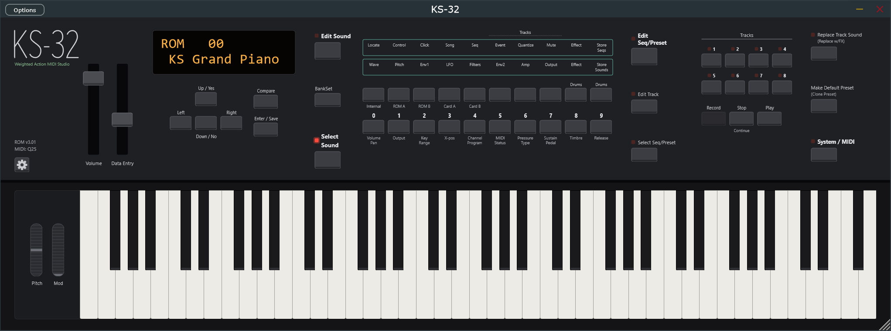

# Ensoniq KS-32 Reborn

An emulator of the Ensoniq KS-32 (1992), the 76-key weighted-action "MIDI Studio" synthesizer. It runs the instrument's own operating system, OS v3.01, from your ROM files on an emulated machine: a 68000 CPU, the ES5505 OTIS wave chip, the ES5510 ESP effects chip, the 68681 DUART and the front panel link. Every screen, sound and effect comes from the original firmware, unmodified.

It is a Windows x64 and Linux x64 app in two formats built from the same code: a **Standalone** program (`KS-32.exe`, `KS-32` on Linux) and a **VST3** instrument (`KS-32.vst3`). Both draw the whole front panel: the 2 x 16 display, the LEDs, every button, the sliders, both wheels and the 76 keys.

## What works

- The factory ROM sounds and effects, played from a MIDI keyboard or the on-screen keys.
- The front panel as on the instrument: every page of the firmware, the two-button combinations
  (right-click or Shift-click latches a button), the service screens.
- Battery memory: settings, edited sounds and sequences survive a restart (the Standalone keeps
  them in a file, the VST3 in the DAW project).
- VST3: the state is saved in the project and comes back with its sound, and Volume, Data Entry,
  the wheels and Sound are host parameters that can be automated.

Not emulated or not done: the memory card (the slot reads empty), MIDI out (the firmware's output is read but not sent anywhere), the Record button (its code was not found), and the glyphs for a few display codes. The details are in [docs/ks32app.md](docs/ks32app.md).

## The ROMs

The ROMs are Ensoniq's copyrighted firmware and samples. The app needs six files in one folder:

| File                         | Size        | What it is           |
| ---------------------------- | ----------- | -------------------- |
| `ks32/ks32v301upper.bin`     | 128 KB      | OS v3.01, upper half |
| `ks32/ks32v301lower.bin`     | 64 KB       | OS v3.01, lower half |
| `sq1-u25.bin`, `sq1-u26.bin` | 512 KB each | Wave ROMs            |
| `rom2.u39`, `rom3.u38`       | 1 MB each   | Wave ROMs            |

On the first start, open the gear on the left of the panel, then **Choose folder…**. A folder named `roms` beside `KS-32.exe` (`KS-32` on Linux) is used automatically when no folder has been chosen.

## Using it

**Standalone.** Run `KS-32.exe` (`KS-32` on Linux). On the gear page, under AUDIO AND MIDI, pick the audio output and enable your MIDI keyboard. The machine boots in real time, as the instrument does, and lands on `ROM 00 KS Grand Piano`.

**VST3.** Copy the `KS-32.vst3` folder to `C:\Program Files\Common Files\VST3` (on Linux `~/.vst3`), rescan plugins in your DAW and add KS-32 to an instrument track. The plugin shares the ROM folder setting with the standalone.

The full guide (settings, memory, the panel, the VST3 state, debug hooks) is
[docs/ks32app.md](docs/ks32app.md).

## Building

Needs Windows, Visual Studio 2022 (MSVC x64) and CMake 3.20 or later. The first configure fetches JUCE 8 (about 150 MB) into the build folder.

```powershell
cmake -S . -B build-app -G "Visual Studio 17 2022" -A x64 -DENS_BUILD_APP=ON
cmake --build build-app --config Release --target KS32_Standalone KS32_VST3 KS32_AppTests
```

The checks that run the firmware read the ROMs from `ks-32/` (`-DENS_ROM_DIR=<folder>` points them elsewhere). The emulator core, its tools and its tests (`src/`, `tools/`, `tests/`) build without JUCE, with MSVC or MinGW-w64:

```powershell
cmake -S . -B build-msvc -G "Visual Studio 17 2022" -A x64
cmake --build build-msvc --config Release
ctest --test-dir build-msvc -C Release --output-on-failure
```

### Linux

Needs GCC (C++17), CMake 3.20 or later, Ninja and JUCE's Linux packages (Ubuntu/Debian names):

```bash
sudo apt install build-essential cmake ninja-build git pkg-config libasound2-dev libjack-jackd2-dev \
  libfreetype-dev libfontconfig1-dev libx11-dev libxcomposite-dev libxcursor-dev libxext-dev \
  libxinerama-dev libxrandr-dev libxrender-dev libgl1-mesa-dev
cmake -S . -B build-linux-app -G Ninja -DCMAKE_BUILD_TYPE=Release -DENS_BUILD_APP=ON
cmake --build build-linux-app --target KS32_Standalone KS32_VST3 KS32_AppTests
```

The outputs are in `build-linux-app/app/KS32_artefacts/Release/` (`Standalone/KS-32`, `VST3/KS-32.vst3`). The core builds the same way without `-DENS_BUILD_APP=ON`.

### A release folder

`tools\dist.ps1` builds the Standalone and the VST3 with the static C++ runtime (no Visual C++ redistributable needed) and assembles `dist\KS-32-<version>` with this README, the license and the app guide:

```powershell
powershell -ExecutionPolicy Bypass -File tools\dist.ps1 -RomFolder ks-32
```

`-RomFolder` copies the six ROM files into the dist's `roms` folder. A dist with ROMs is for your own use: do not publish it. Without `-RomFolder` the dist holds no Ensoniq material.

On Linux, `tools/dist.sh [--rom-folder ks-32]` does the same into `dist/KS-32-<version>-linux`, with libstdc++ and libgcc linked statically.

## How it is built

| Folder                | What                                                                                  |
| --------------------- | ------------------------------------------------------------------------------------- |
| `src/m68k`            | The 68000 core, checked cycle by cycle against Tom Harte's single-step tests          |
| `src/otis`, `src/esp` | The ES5505 OTIS and ES5510 ESP, written from the datasheets                           |
| `src/duart`           | The 68681 DUART (MIDI and the panel link)                                             |
| `src/ks32`            | The KS-32 machine: memory map, panel protocol, keyboard, analog inputs, battery RAM   |
| `src/app`             | The real-time engine the app drives, and the panel layout                             |
| `app/`                | The JUCE Standalone and VST3                                                          |
| `tools/`              | `ks32emu` (boot, render a MIDI file, live play from the command line) and other tools |
| `docs/`               | Designs, decisions, verification reports and hardware notes                           |

The firmware is run, never decompiled: hardware behaviour comes from the service manual, the chip datasheets and bus traces of the running OS. MAME is used only as a comparison point.

## License

Copyright (C) 2026 Anthony C. Bartman (@rommix0)

This program is free software: you can redistribute it and/or modify it under the terms of the GNU Affero General Public License as published by the Free Software Foundation, either version 3 of the license, or (at your option) any later version. It is distributed WITHOUT ANY WARRANTY; see [LICENSE](LICENSE) for the full text.

The app is built on [JUCE](https://juce.com), used under the AGPLv3, and includes the Steinberg
VST3 SDK (MIT). `tools/mame_ref/vendor/` holds unmodified MAME sources under their own BSD-3-Clause license, used only by an optional reference tool, not by the app.

Ensoniq and KS-32 are trademarks of their respective owners. This project is not affiliated with or endorsed by them. The ROMs are not covered by this license.
